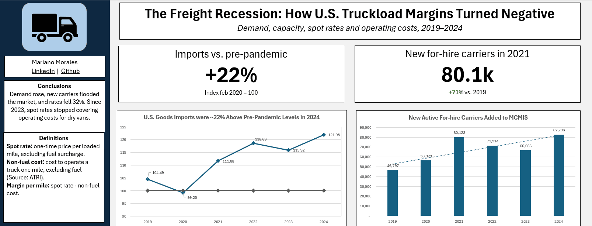

# The Freight Recession: How U.S. Truckload Margins Turned Negative

**An analysis on demand, capacity, spot rates and operating costs, 2019–2024**

<!-- 1 sentence: what you did + tools + main result. This is the most-read line of the whole README. -->
End-to-end Excel analysis of U.S. freight indicators, built with **Power Query, Power Pivot (DAX) and an interactive dashboard**, showing how truckload carriers went from earning **+$0.91** per mile in 2021 to losing **−$0.19** per mile in 2024.




<!-- Main GIF: 10–15 s using the slicers on the dashboard. -->

---

## Key Findings

<!-- 3–4 bullets, each one with a number. Verify every figure against your dashboard. -->
- **Demand boom (2020–2021):** ...
- **Capacity surge:** new for-hire carrier registrations ...
- **Rates fell, costs rose:** Dry Van spot rates fell 32% (2021–2024) while non-fuel operating costs rose 24%.
- **It wasn't diesel:** rates started falling in early 2022, before diesel peaked ...

## The Question

<!-- 1 or 2 sentences. Add one line on why it matters to a carrier or a shipper — your transport experience helps here. -->
What drove U.S. truckload spot rates and carrier profitability between 2019 and 2024?

## Skills Used in this project

| Area | What I did |
|---|---|
| **Power Query (ETL)** | Cleaned 30K+ rows: text dates to real dates, broken encoding, blank values, weekly and monthly series grouped to monthly, annual costs expanded to monthly grain |
| **Data Modeling** | Star schema in Power Pivot with a Calendar dimension and one-to-many relationships to 5 fact tables |
| **DAX** | Measures for average spot rate, non-fuel cost, margin per mile (with blank-period handling) and margin % |
| **CUBEVALUE** | KPI cards that read measures straight from the data model and respond to slicers |
| **PivotTables & PivotCharts** | Yearly and monthly analysis by trailer type (Dry Van, Refrigerated, Flatbed) |
| **Dashboard Design** | Synced slicers, KPI cards, dynamic titles, conditional formatting, custom number formats |


<!-- Keep only what you actually used. In an interview they may ask about any row. -->

## Data Sources

- [**U.S. Bureau of Transportation Statistics (BTS)** – Supply Chain and Freight Indicators.](https://catalog.data.gov/dataset/supply-chain-and-freight-indicators?from_hint=eyJxIjoic3VwcGx5IGNoYWluIn0%3D) <!-- link -->
- [**ATRI** – Operational Costs of Trucking, cost per mile by component, 2017–2025.](https://truckingresearch.org/2025/07/an-analysis-of-the-operational-costs-of-trucking-2025-update/) <!-- link -->

## Process

### 1. Data Cleaning (Power Query)
<!-- 2–3 lines + screenshot of the Applied Steps panel. -->


### 2. Data Model (Power Pivot)
<!-- Screenshot of the diagram view. Calendar should show the "1" side of every relationship. -->


### 3. DAX Measures
```dax
Margin per Mile :=
IF ( ISBLANK ( [Avg Spot Rate] ), BLANK (),
     [Avg Spot Rate] - [Non-Fuel Cost] )
```
<!-- 1 line explaining why the IF matters (rates end May 2024, costs go to 2025). Show 1–2 measures only. -->

### 4. Dashboard

<!-- Optional second GIF: changing trailer type and seeing the KPIs update. -->

## Limitations

- Spot rate data ends in **May 2024**, so 2024 covers January–May only.
- ATRI costs are annual; each month uses its year's cost.
- The analysis shows correlation, not causation.

## Repository Structure

```
├── Freight_Analysis.xlsx
├── data/          # raw source files
├── images/        # screenshots and GIFs for this README
└── README.md
```

## How to Use

Download `Freight_Analysis.xlsx` and open it in Excel for Windows (Power Pivot required). Use the slicers on the **Dashboard** sheet.

## Author

**Mariano Morales** · [LinkedIn](URL) · [Email](mailto:...)
